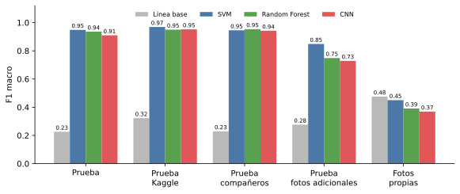
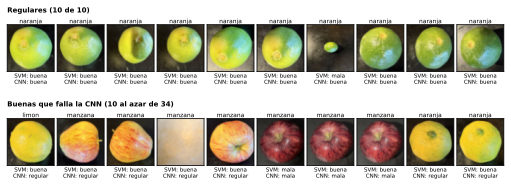

# 5. Evaluación

Esta fase mide el desempeño de los modelos sobre datos no vistos y analiza los resultados. El código se encuentra en [`src/evaluation`](../src/evaluation) y las figuras, en formato vectorial (SVG y PDF), en [`experiments/results/`](../experiments/results).

## Métricas

Se reportan exactitud, precisión, exhaustividad y F1 por clase, el F1 macro (promedio de los F1 de las clases presentes en el conjunto) y la matriz de confusión. Los modelos se evalúan en cinco conjuntos: prueba (1.250 imágenes), prueba restringida a Kaggle (699), a imágenes de otros grupos (445) y a las fotografías adicionales (106), y fotografías propias (106). Solo las fotos propias quedan fuera del entrenamiento y de la selección de modelos.

| Modelo | Prueba | Prueba Kaggle | Prueba otros grupos | Prueba fotos adicionales | Fotos propias |
|---|---|---|---|---|---|
| Línea base | 0,23 | 0,32 | 0,23 | 0,28 | 0,48 |
| SVM | **0,95** | **0,97** | 0,95 | **0,85** | **0,45** |
| Random Forest | 0,94 | 0,95 | 0,95 | 0,75 | 0,39 |
| KNN | 0,94 | 0,96 | **0,96** | 0,77 | 0,40 |
| Regresión logística | 0,73 | 0,80 | 0,81 | 0,43 | 0,37 |
| CNN | 0,91 | 0,95 | 0,94 | 0,73 | 0,37 |

(F1 macro. En las fotos propias solo existen las clases buena y regular.) La tabla completa, con la exactitud, está en [`experiments/results/resumen.csv`](../experiments/results/resumen.csv).

Las fotografías adicionales son 633 imágenes de banano, guayaba, limón, manzana y naranja (401 buenas, 160 regulares y 72 malas), originales, de al menos 128 px de lado mayor y sin duplicados exactos de las demás fuentes ni entre sí. La clase se toma del nombre de la carpeta. Forman parte del reparto: 428 están en entrenamiento, 99 en validación y 106 en prueba, de modo que su prueba mide el desempeño en una fuente que los modelos sí conocen.



## Análisis

- **Desempeño en distribución.** Con imágenes de las mismas fuentes que el entrenamiento, el SVM acierta el 95,8 % de la prueba, con F1 de 0,97 en buena, 0,92 en regular y 0,96 en mala; el Random Forest, el 94,4 % (0,95, 0,91 y 0,94) y la CNN, el 93,3 % (0,95, 0,84 y 0,94). Los modelos clásicos superan ligeramente a la CNN (F1 macro de 0,95 y 0,94 frente a 0,91), lo que sugiere que el color y la textura globales bastan para esta tarea. Las alternativas simples respaldan la elección del SVM: la regresión logística queda muy por debajo (F1 macro de 0,73), de modo que la frontera no es lineal en estas características, y KNN con $k = 1$ iguala a los modelos clásicos en la prueba (0,94). Con paciencia de 8 épocas la CNN mejora 8 puntos de F1 macro en prueba respecto de la paciencia de 4 (de 0,83 a 0,91); ver [`4_modelado/deep_learning`](../4_modelado/deep_learning).
- **Cambio de dominio.** Con fotos propias la exactitud cae a 0,81 (SVM), 0,64 (Random Forest) y 0,58 (CNN), y a 0,47 (KNN) y 0,48 (regresión logística), por debajo de la línea base (0,91) en todos los casos. En F1 macro, que aquí solo promedia buena y regular, la línea base obtiene 0,48 y ningún modelo la supera: SVM 0,45, KNN 0,40, Random Forest 0,39, CNN y regresión logística 0,37. Las fotos propias son más oscuras (brillo medio de 70 a 98, frente a 148 a 182 en las otras fuentes) y con fondos distintos. El SVM clasifica como mala 10 de las 96 fotos buenas (5 manzanas, 4 limones y 1 naranja) y no acierta ninguna de las 10 regulares (9 como buenas y 1 como mala). El Random Forest clasifica como mala 12 buenas y como regular 16, y tampoco acierta ninguna regular. La CNN clasifica como mala 16 buenas (todas manzanas) y como regular 18 (10 manzanas, 5 limones y 3 naranjas), y clasifica las 10 regulares como buenas. La exactitud de la CNN en fotos propias es sensible a la configuración y a la paciencia (0,65, 0,58 y 0,61 con paciencia de 8; 0,43, 0,70 y 0,61 con paciencia de 4), de modo que, con 106 imágenes, ese valor no permite atribuirle un desempeño estable.
- **Fotos adicionales.** En la prueba de esa fuente (106 imágenes, de las cuales 10 son malas) el SVM obtiene exactitud de 0,91 y F1 macro de 0,85, el Random Forest 0,85 y 0,75, la CNN 0,79 y 0,73, y la línea base 0,71 y 0,28. El recall de la clase mala es de 0,70 en el SVM, 0,50 en el Random Forest y 0,70 en la CNN, con 10 imágenes. Como esas fotos también están en el entrenamiento y hay varias de una misma fruta, estos valores son optimistas. En un experimento previo, con las 633 imágenes fuera del entrenamiento, el F1 macro fue de 0,40 (SVM), 0,52 (Random Forest) y 0,39 (CNN); la diferencia ilustra cuánto depende el desempeño de que la fuente esté en el entrenamiento.
- **Efecto de la normalización.** Con el SVM de un experimento previo, normalizar el brillo, equilibrar el color (gray-world) o aplicar CLAHE a las fotos propias antes de extraer características no resolvió el problema: la mejor variante (CLAHE) subió la exactitud de 0,77 a 0,79 y las demás la empeoraron. No se repitió con los modelos actuales.
- **Sobreajuste.** En la mejor época, la CNN tiene exactitud de 0,92 en entrenamiento y 0,93 en validación (con aumento de datos y dropout activos solo en entrenamiento), por lo que no hay sobreajuste. En el SVM, el F1 de validación cruzada (0,940) y el de validación (0,951) y prueba (0,949) coinciden, y en el Random Forest también (0,927, 0,939 y 0,936).
- **Clase Regular.** En la prueba tiene el menor F1 en los tres modelos (0,92 en el SVM, 0,91 en el Random Forest y 0,84 en la CNN). En las fotos propias el recall es de 0 en los tres, con solo 10 imágenes, todas naranjas de color verdoso o amarillo verdoso que los modelos reconocen como fruta buena.
- **Por fruta.** En la prueba el SVM y el Random Forest superan 0,88 de exactitud con todas las frutas y la manzana es la más difícil (0,92 y 0,88); la CNN baja a 0,88 en manzana y 0,89 en naranja. En las fotos propias el desempeño depende de la fruta: la manzana (64 fotos) se acierta en 0,92 con el SVM, 0,80 con el Random Forest y 0,59 con la CNN; el limón (25), en 0,84, 0,68 y 0,80; y la naranja (17), en 0,35, 0 y 0,24 ([`exactitud_por_fruta.svg`](../experiments/results/exactitud_por_fruta.svg)).
- **Errores en fotos propias.** En la muestra de la figura (las 10 regulares y 10 buenas que falla la CNN, elegidas al azar), las manzanas rojas oscuras las clasifican como malas tanto el SVM como la CNN, y las manzanas y naranjas de tono amarillento, la CNN las clasifica como regulares; una de las manzanas es un recorte defectuoso (solo se ve piel clara). Es una muestra pequeña, por lo que solo ilustra los tipos de error ([`errores_fotos_propias.svg`](../experiments/results/errores_fotos_propias.svg)).



## Limitaciones de la evaluación

Los casi duplicados no se detectaron y la partición es aleatoria por archivo, por lo que los valores en prueba pueden ser optimistas, sobre todo en las fotografías adicionales, que incluyen varias fotos de una misma fruta. La prueba de las fotos adicionales tiene 106 imágenes, 10 de ellas malas. El conjunto de fotos propias tiene 106 imágenes, sin ninguna mala y con 10 regulares, todas naranjas (la clase queda confundida con la fruta), de modo que sus métricas tienen alta incertidumbre y solo indican la tendencia. En las fotografías adicionales la etiqueta proviene del nombre de la carpeta y no se verificó imagen por imagen, y la cobertura es desigual: el limón solo tiene buenas, la guayaba no tiene malas y la manzana tiene 5 regulares. La estimación de tamaño no se validó contra etiquetas porque ninguna fuente las incluye.

## Reproducción

```bash
python -m src.evaluation.analisis
python -m src.evaluation.errores
```

Regenera las predicciones, la tabla de resultados y las figuras a partir de los modelos de `experiments/checkpoints/`; `errores` dibuja las fotos propias mal clasificadas.
